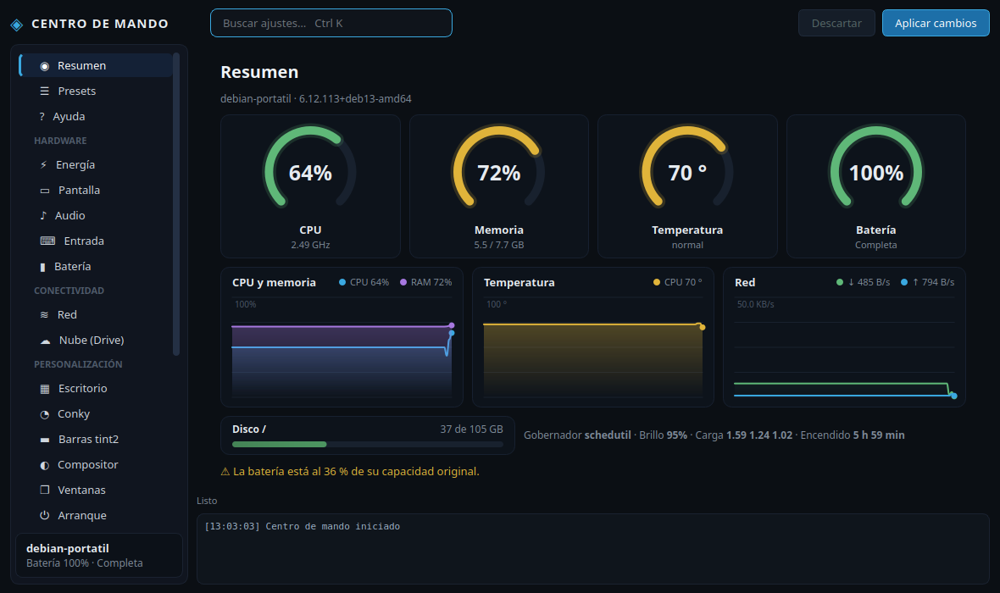
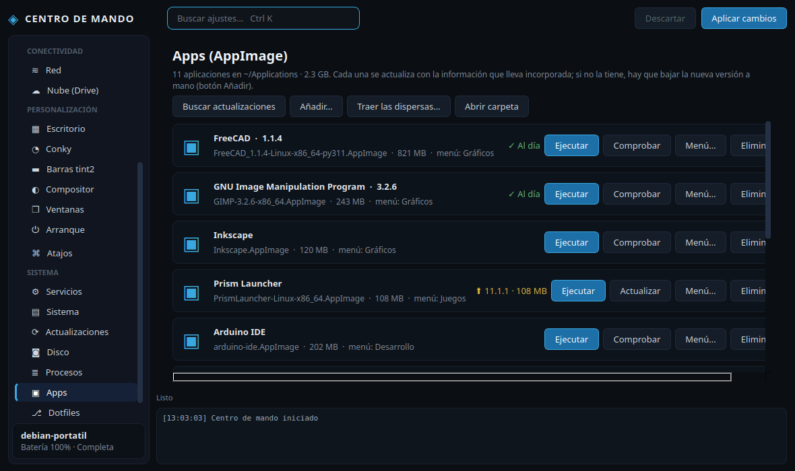
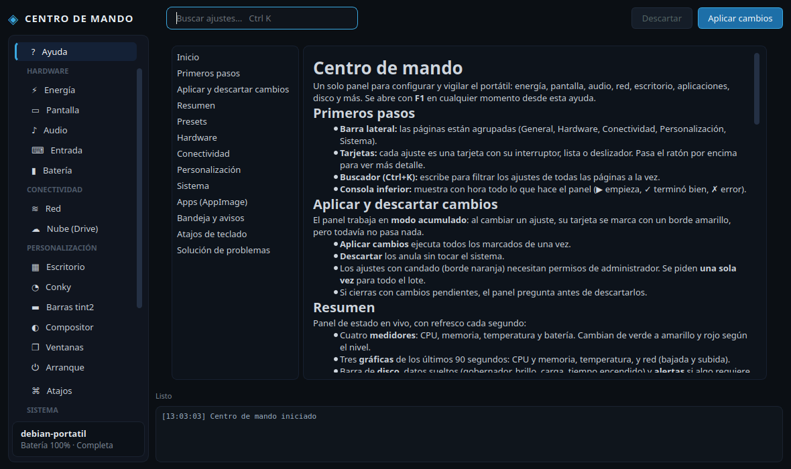

# Centro de mando

Un solo panel para configurar y vigilar un portátil Linux con escritorio ligero (pensado para
**Debian 13 + Openbox**, sin gestor de sesión). Hecho con **PyQt6**, tema oscuro, barra lateral por
categorías y todo en español. La guía de uso completa está en [`AYUDA.md`](AYUDA.md) y también se abre
dentro de la app con **F1**.



## Qué hace

- **Resumen gráfico:** medidores (CPU, memoria, temperatura, batería), gráficas de 90 s (CPU+RAM,
  temperatura, red), disco y alertas.
- **Ajustes de todo el equipo:** energía (TLP), pantalla, audio, entrada, red, escritorio, ventanas,
  compositor (picom), barras (tint2), conky, servicios y arranque.
- **Modo acumulado:** marcas varios cambios y los aplicas juntos; los que necesitan root piden **una
  sola** contraseña (`pkexec`).
- **Presets** Ahorro / Equilibrado / Rendimiento con vista previa y reversión.
- **Apps (AppImage):** todas en `~/Applications`; ejecutar, actualizar (con la papelera como red de
  seguridad), eliminar y añadir al menú eligiendo la sección.
- **Disco:** particiones, limpieza de apt/journal y caché por programa con botón de borrado.
- **Atajos de Openbox** editables, **Dotfiles** (commit/push desde el panel) y **Procesos**.
- **Bandeja y avisos de escritorio:** batería baja/crítica, CPU caliente, disco lleno y AppImage nuevas.

| Apps | Ayuda |
|---|---|
|  |  |

## Requisitos

Imprescindible: **Python 3.11+** y **PyQt6** (`sudo apt install python3-pyqt6`).

Opcionales (cada ajuste se desactiva solo si falta su programa): `tlp`, `brightnessctl`, `picom`,
`conky`, `tint2`, `nmcli`, `rfkill`, `wpctl` (PipeWire), `xinput`, `xrandr`, `rclone`, `libnotify-bin`
(avisos), `policykit-1` con un agente en marcha como `lxpolkit` (acciones de administrador).

## Instalación

```sh
git clone <url-del-repositorio> ~/panel-portatil
cd ~/panel-portatil
./install.sh          # crea el lanzador, el icono y la entrada de menú
panel-portatil        # o desde el menú: «Centro de mando»
```

Opciones de línea de comandos:

| Opción | Efecto |
|---|---|
| `--tray` | Arranca oculto en la bandeja (para el autostart de Openbox) |
| `--apply` | Reaplica ajustes de sesión (touchpad, teclado, DPMS, color) y sale |

Desinstalar: `./install.sh --uninstall`.

## Estructura

| Archivo | Contenido |
|---|---|
| `panel.py` | Ventana, barra lateral, tarjetas, modo acumulado, presets, resumen, bandeja |
| `settings.py` | Clase `S` (un ajuste) y todas las categorías en `build()` / `CATEGORIES` |
| `pages.py` | Páginas de información: Batería, Procesos, Atajos, Disco, Actualizaciones, Dotfiles, Ayuda |
| `apps.py` | Gestor de AppImage: escaneo, actualización, menú, papelera |
| `dash.py` | Widgets gráficos del Resumen (`Gauge`, `AreaChart`, `Bar`) |
| `notify.py` | Avisos de escritorio con histéresis y comprobación periódica de AppImage |
| `deskcfg.py` | Edición segura de autostart, picom, rc.xml, tint2 y conky (con copia de seguridad) |
| `root_helper.py` | Operaciones con root, **solo de una lista blanca**, vía `pkexec` |
| `AYUDA.md` | Guía de usuario; la muestra la página Ayuda |
| `install.sh` | Instalador / desinstalador por usuario |

## Desarrollo

- **Añadir un ajuste:** un `S(id, categoría, título, descripción, tipo, get=…, set=…)` en `settings.py`.
  Tipos: `toggle`, `choice`, `slider`, `button`. Con `root=lambda v: [[op, …]]` se ejecuta como root.
- **Añadir una categoría:** una tupla en `CATEGORIES`.
- **Añadir una página informativa:** clase en `pages.py` registrada en `PAGES` (misma clave que la categoría).
- **Añadir una operación root:** función `op_*` en `root_helper.py` y entrada en `OPS`, validando los argumentos.
- **Probar sin abrir ventana:** `QT_QPA_PLATFORM=offscreen` y `widget.grab().save("captura.png")`.

### Cómo funciona por dentro

- Antes de editar `autostart`, `rc.xml`, `picom.conf`, `.tint2rc` o `.conkyrc` se copia el original en
  `~/.config/panel-portatil/backups/`. Varios cambios en la misma herramienta = una sola recarga.
- La actualización de AppImage lee la sección ELF `.upd_info` (`gh-releases-zsync` vía API de GitHub, o
  `zsync|URL` comparando `Length`); descarga a `.nombre.part`, comprueba que sea ELF y solo entonces
  sustituye. La versión anterior va a la papelera (`gio trash`).
- Los avisos se evalúan cada 30 s; cada uno salta una vez y se rearma al normalizarse. El resultado de
  comprobar AppImage se guarda en `~/.config/panel-portatil/app-updates.json`.
- Estado de sesión en `~/.config/panel-portatil/state.json`; preferencias en `prefs.json`.
- Los widgets de tarjeta deben tener padre antes de mostrarse (si no, parpadean como ventanas sueltas).
- Nunca usar `pkill -f` con la ruta del script en la propia línea de comandos: mata la shell.

## Seguridad

`root_helper.py` se ejecuta como root mediante `pkexec` y solo acepta operaciones de una lista blanca con
los argumentos validados. Aun así, es un archivo del usuario: **quien pueda editarlo puede escalar
privilegios**. Para endurecerlo, instálalo en `/usr/local/lib` con dueño root y añade una política polkit.

## Licencia

Sin licencia definida todavía (todos los derechos reservados por defecto).
